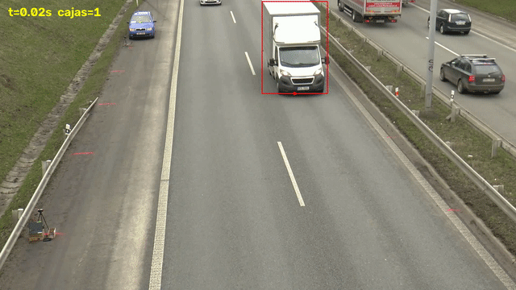

# Radar de tráfico por visión

Estima la velocidad de cada vehículo en el vídeo de una cámara fija de tráfico, sin radar ni LiDAR:
solo detección con YOLO, seguimiento con ByteTrack y geometría.



## Resultados

Evaluado frente a las velocidades medidas con LiDAR del dataset **BrnoCompSpeed** (`session2_center`).
El vídeo se divide en el tiempo: los primeros 20 minutos para ajustar y el resto (~36 min) como test, evaluado una sola vez.

En test, el radar mide 932 de los 960 coches de referencia con un error medio de **1,5 km/h**, y el 95 % de ellos con menos de 3 km/h de error.
El sesgo positivo (~+0,8 km/h) se repite en los dos bloques, así que es sistemático.

| Métrica | Ajuste (0–1200 s) | Test (1200 s–final) |
|---|---|---|
| Coches válidos de referencia | 325 | 960 |
| Cobertura (coches de referencia medidos) | 97,5 % | **97,1 %** |
| Error medio absoluto | 1,82 km/h | **1,51 km/h** |
| Sesgo (error medio con signo) | +0,75 km/h | +0,79 km/h |
| Coches con \|error\| < 3 km/h | 93,1 % | **95,2 %** |

## Cómo funciona

```
vídeo ──► YOLO11n ──► máscara ──► ByteTrack ──► cruce de líneas ──► velocidad
          (COCO)      (zona de    (ID por       (t4 y t0 de        D / (t0 − t4)
                       interés)    vehículo)     cada ID)
```

1. **Detección.** `yolo11n` preentrenado en COCO, clases coche, moto, autobús y camión. Sin reentrenar.
2. **Máscara.** Una caja solo cuenta si su punto de contacto con el suelo (centro del borde inferior)
   cae dentro de la zona de interés. Así se descartan la otra calzada y el arcén.
3. **Seguimiento.** ByteTrack (configuración por defecto de Ultralytics) asigna un ID persistente a cada vehículo.
4. **Cruce de líneas.** Dos líneas de medida cruzan la carretera. Un vehículo cruza una línea en el primer
   frame en que su punto de contacto queda por debajo de ella; así se obtienen los instantes `t4` y `t0`.
5. **Velocidad.** `v = D / (t0 − t4) × 3,6`, donde `D` es la distancia real entre las dos líneas,
   calibrada una sola vez con los coches del bloque de ajuste (mediana de `velocidad × tiempo`).

## Datos

[BrnoCompSpeed](https://github.com/JakubSochor/BrnoCompSpeed): vídeos de cámaras de tráfico con la velocidad de cada vehículo medida con LiDAR. Se usa la sesión `session2_center` (1920×1080, 50 imágenes/s, ~56 min). Los datos no se incluyen en el repositorio.

## Estructura

```
src/
  videodata.py       lectura de frames por tiempo
  tracking.py        detección + ByteTrack, filtro de máscara, líneas de medida
  velocidad.py       cruce de líneas, calibración de D, velocidades
  evaluacion.py      emparejamiento con la referencia y error
  generarsalidas.py  vídeo anotado
  carsdata.py        utilidades sobre la referencia
  pipeline.py        radar(): clip → velocidades.csv + vídeo anotado
notebooks/
  1-0-exploracion-del-set.ipynb   exploración del dataset y primeras detecciones
  2.0-calculos-velocidad.ipynb    tracking, velocidad y evaluación del bloque de ajuste
  3-0-ejecucion-test.ipynb        evaluación única sobre el bloque de test (Colab)
  demostracion.ipynb              el radar completo sobre un clip de 30 s
config/
  calibracion.json   calibración fija de la cámara: líneas de medida y distancia D
  video_mask.png     zona de interés
data/        (no incluido) vídeo, máscara y referencia
```

## Uso

```bash
python -m venv .venv
source .venv/bin/activate
pip install -r requirements.txt
```

Para medir un clip de la misma cámara:

```python
import sys; sys.path.append("src")
from pipeline import radar

res = radar("clip.mp4", "config/calibracion.json",
            salida_video="radar.mp4", salida_csv="velocidades.csv")
```

La detección sobre el vídeo completo se ejecutó en Google Colab con GPU, por trozos de 60 s
(con 5 s de solape) guardados en CSV. El cálculo de velocidades y la evaluación sobre esos CSV
funcionan en local sin GPU.

## Detalles técnicos

- **Escala de tiempo.** El contenedor del vídeo declara 100 fps, pero el decodificador entrega 50
  imágenes por segundo. Saltar por número de frame lleva a instantes equivocados y deja las
  velocidades mal por un factor 2. Por eso los frames se leen por tiempo (`CAP_PROP_POS_MSEC`).
- **Coches que aparecen tarde.** Si YOLO detecta un vehículo por primera vez cuando ya ha pasado la
  primera línea, su tiempo de cruce es erróneo. Esas trayectorias se descartan; sin este filtro el
  error medio era de 33,7 km/h.
- **Sin fuga de datos.** La distancia `D` se calibra solo con coches del bloque de ajuste.
- **Resolución temporal.** A 50 imágenes/s, un frame de diferencia equivale a unos 2 km/h a 95 km/h.

## Limitaciones

- **Calibración por escena.** Las líneas de medida y la distancia `D` salen de la anotación del dataset: para otra cámara habría que marcarlas de nuevo (o calcularlas con una homografía).
- **Una sola `D` para los dos carriles.** El sesgo viene del carril: el radar mide de más en el carril 0
  y un poco de menos en el 1. Con una `D` por carril, el error medio en ajuste baja de 1,82 a 1,55 km/h
  y el sesgo de +0,75 a +0,13 (no integrado en el radar).
- **Emparejamiento de la evaluación.** Cada medida se empareja con la referencia solo por el instante de cruce de la primera línea. Cuando dos coches de carriles distintos la cruzan a la vez, a veces se comparan con el coche equivocado: unos 14 casos en ajuste, que inflan el error medio.
- **Precisión del cruce.** El instante de cruce se redondea al frame.
